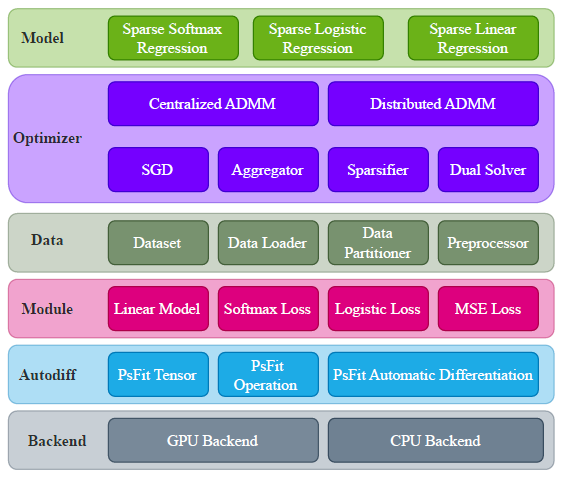

# PsFiT — Parallel Sparse Fitting Toolbox

PsFiT is a Python toolbox for fitting **sparse linear models** with an L0 constraint. It provides centralized and Ray-based distributed ADMM training, a small autodiff engine, data utilities, and CPU/GPU backends.

<p align="center">
  
</p>

## What you can do

- Train sparse linear regression and softmax classification models with ADMM.
- Apply projection-based L0 sparsification or other aggregation components.
- Run local training or coordinate distributed workers through Ray.
- Use the included datasets, batching, partitioning, preprocessing, losses, and autodiff utilities.

## Installation

PsFiT requires **Python 3.10 or newer**. Install it from PyPI:

```bash
python -m pip install psfit
```

This installs the declared dependencies, including NumPy, PyTorch, scikit-learn, and Ray. PsFiT uses its NumPy backend by default. To select the PyTorch backend, set `backend=pytorch` before starting Python; this backend requires an available CUDA device:

```bash
backend=pytorch python train.py
```

## Quick start: sparse linear regression

This example creates a small synthetic regression dataset, fits a linear model, and constrains its coefficients to three nonzero values with the projection sparsifier.

```python
import numpy as np

from psfit import Linear, MSELoss, RandomRegressionDataset
from psfit.data import DataLoader
from psfit.optim import LocalTrainer, ProjectionSparsifier, SGD
from psfit.optim.optimizer import Admm

# Generate y = Xw + noise, with three nonzero coefficients.
dataset = RandomRegressionDataset(m=256, n=20, variance=0.01)
w_true = np.zeros((20, 1))
w_true[:3] = 1.0
dataset.populate(w_true)

model = Linear(in_features=20, out_features=1)
loader = DataLoader(dataset, batch_size=32, shuffle=True, report=False)
trainer = LocalTrainer(
    dataloader=loader,
    loss=MSELoss(),
    optimizer=SGD(model, learning_rate=0.01),
    epochs=3,
    verbose=False,
)
optimizer = Admm(
    trainer=trainer,
    aggregators=ProjectionSparsifier(density=3),
)

for _ in range(10):
    loss, residual = optimizer.step(penalty=1.0)

print(f"loss={loss:.4f}, primal residual={residual:.4f}")
print("weights:", model.weights.array())
```

`density` is the number of coefficients retained in each output column. For classification, PsFiT also provides `SoftmaxLoss`, `SparseSoftmaxClassifier`, and the `MNIST` and `Imdb` dataset helpers.

## Distributed training with Ray

The distributed API uses a parameter server, worker configurations, dataset partitions, and `DistributedDataParallel`. See the complete [distributed MNIST softmax-classification notebook](examples/distributed_sparse_softmax_classifier.ipynb) for an end-to-end example.

The `MNIST` helper expects an NPZ archive with `training_data`, `training_labels`, and `test_data` arrays. The distributed notebook initializes Ray, partitions the training dataset across workers, configures each worker, and runs ADMM rounds. Ray must be initialized before creating distributed workers; call `ray.shutdown()` when training is finished.

For a centralized classifier that uses validation data, initialize the dataset with `cv=True` (for example, `MNIST(path, preprocessor=ImageNormalizer(), cv=True)`) and pass it to `SparseSoftmaxClassifier`.

## Project layout

| Path | Contents |
| --- | --- |
| [`psfit/`](psfit/) | Models, data utilities, autodiff, backend, and optimizers |
| [`examples/`](examples/) | Jupyter notebooks demonstrating regression and classification workflows |
| [`benchmarks/`](benchmarks/) | Benchmark scripts for MNIST and IMDb experiments |
| [`docs/`](docs/) | Sphinx documentation source |

The high-level package architecture is shown below:

<p align="center">
  
</p>

## Development and tests

To install the runtime dependencies and run the test suite from a source checkout:

```bash
python -m pip install -r requirements.txt
python -m unittest discover -s tests
```

## License

PsFiT is distributed under the [MIT License](LICENSE).
